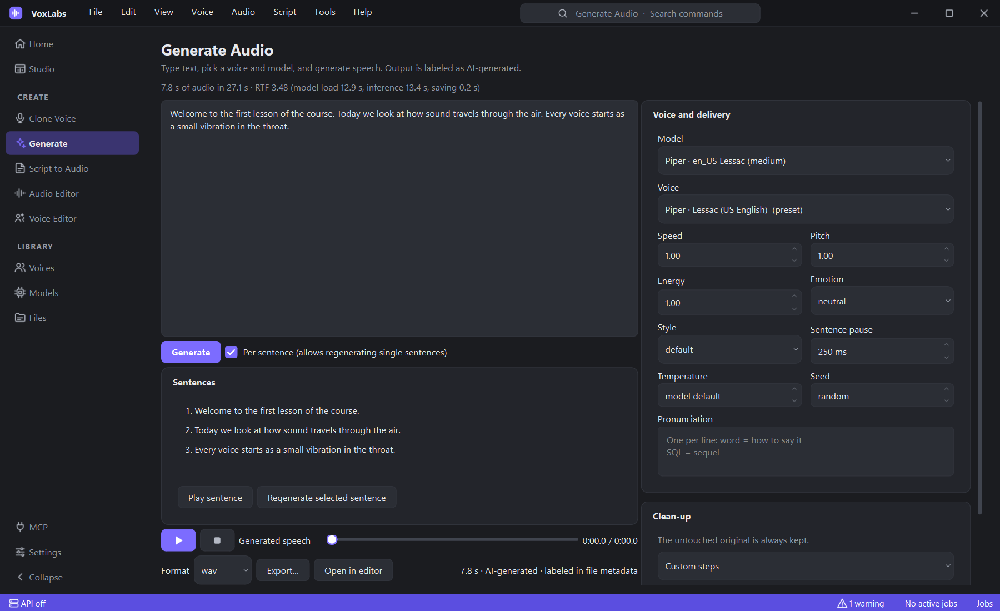
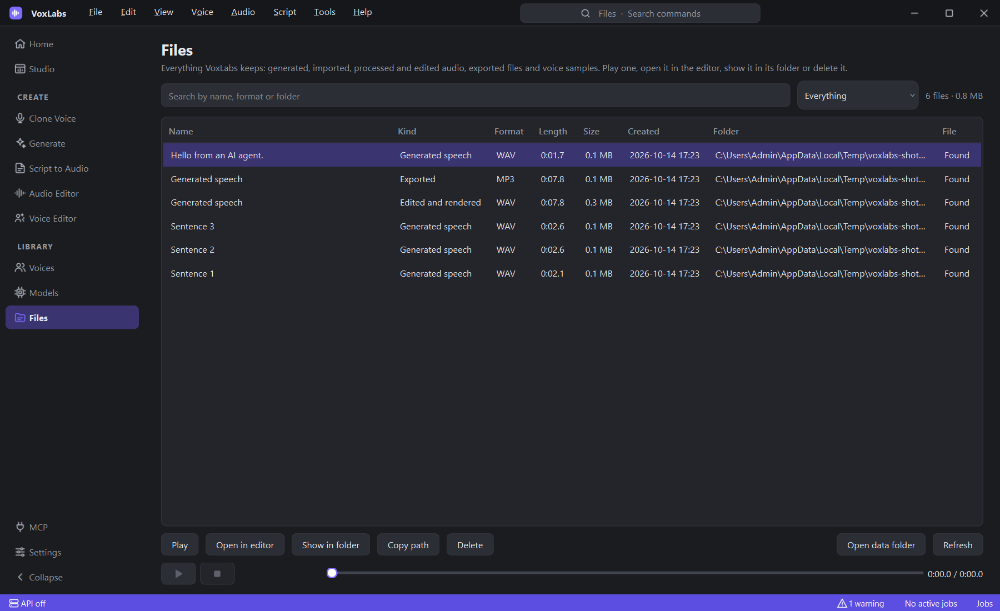
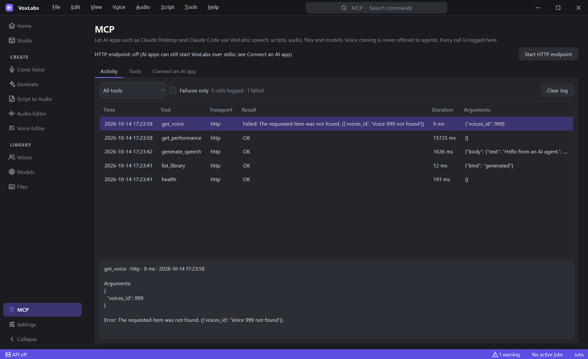
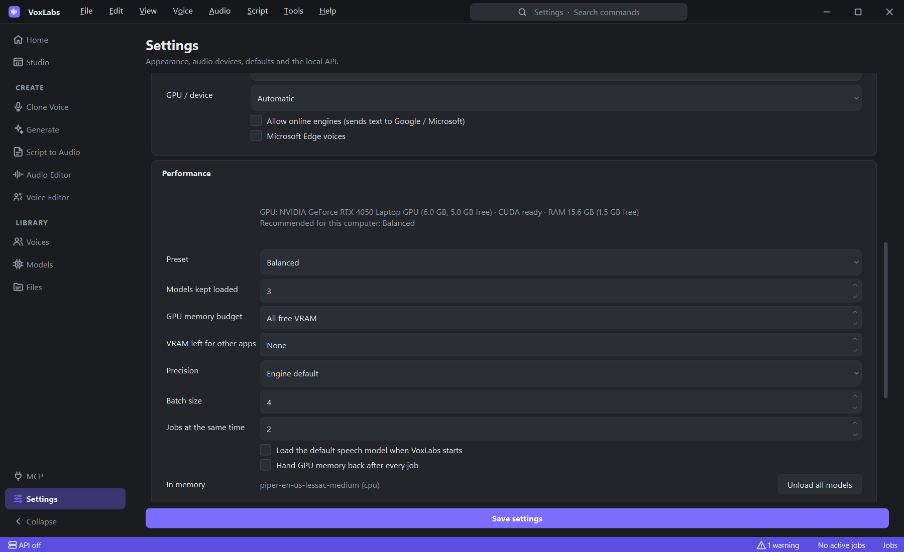

<!-- markdownlint-disable-file MD033 MD041 -- the centered header, logo and screenshots need HTML on GitHub -->
<div align="center">


# VoxLabs

**Clone voices with consent, turn text and lessons into natural speech, and polish audio, all on your own computer.**

[](https://github.com/nishanth-kj/VoxLabs/releases/latest)
[](https://github.com/nishanth-kj/VoxLabs/actions/workflows/ci.yml)
[](https://github.com/nishanth-kj/VoxLabs/actions/workflows/desktop.yml)
[](./LICENSE)
[](https://www.python.org)
[](#-download)
[](#-use-it-from-ai-apps-mcp)

[**Download**](https://github.com/nishanth-kj/VoxLabs/releases/latest) ·
[Website](https://nishanth-kj.github.io/VoxLabs/) ·
[Documentation](#-documentation) ·
[Report a bug](https://github.com/nishanth-kj/VoxLabs/issues)



</div>

## Why VoxLabs

- 🔒 **Private by default.** The speech engines run on your computer. Nothing is uploaded unless you turn on an online engine.
- 🎙️ **Real voice cloning, done responsibly.** Every cloned voice records who consented and when, and revoking it deletes its samples on the spot.
- 🎧 **A complete studio.** Text to speech, multi-speaker scripts and lessons, a non-destructive editor and one-click clean-up live in one desktop app.
- ⚡ **Fast and honest about it.** Models load once and stay ready. Every generation shows its real speed (audio length, time taken, real-time factor) and where the time went.
- 🤖 **Works with your AI apps.** Claude Desktop, Claude Code and other MCP clients can generate speech, run scripts and manage files, and every call they make is logged.

## Contents

- [Features](#-features)
- [Screenshots](#-screenshots)
- [Download](#-download)
- [Run from source](#-run-from-source)
- [Your first audio in five minutes](#-your-first-audio-in-five-minutes)
- [Speech engines](#-speech-engines)
- [Use it from AI apps (MCP)](#-use-it-from-ai-apps-mcp)
- [REST API](#-rest-api)
- [Performance](#-performance)
- [Documentation](#-documentation)
- [Development](#-development)
- [Privacy and responsible use](#-privacy-and-responsible-use)
- [License](#-license)

## ✨ Features

| | |
| --- | --- |
| **Voice cloning with consent** | Import or record samples, get a quality report, record who consented, then clone. Revoke a voice to delete its data, or delete it completely. |
| **Text to speech** | Voice, model, speed, pitch, energy, emotion, style, pauses, pronunciations, temperature and seed. Regenerate a single sentence without redoing the rest. |
| **Scripts and lessons** | Chapters, sections and speakers (`Teacher: …`) mapped to voices, per-section settings, several takes per section, intro and outro, and a final render. |
| **Video dubbing** | Multi-speaker video dubbing: extract media audio, align SRT/WebVTT subtitles with millisecond precision, map speakers to voices, detect duration conflicts without silent audio warping, duck background audio, and remux synchronized output video. |
| **Audio editor** | Non-destructive waveform editing: cut, copy, paste, split, trim, move, duplicate, join, fade, volume, normalize, undo and redo, and loop playback. Edits autosave. |
| **Enhancement** | Denoise, EQ, compression, de-esser, limiter and loudness, with the presets Voice Clean, Podcast, Narration, Lesson, Studio and Raw. The untouched original is always kept. |
| **Files** | One Library page lists everything VoxLabs keeps: generated, imported, processed and edited audio, every export wherever you saved it, and voice samples. |
| **Local models** | Piper, Kokoro, Chatterbox, Chatterbox Turbo and Qwen3-TTS on the CPU or a CUDA GPU. Idle models make room on the GPU before anything falls back to the CPU. |
| **Background jobs** | Long work never freezes the window. Each job shows what it is doing ("Chunk 3 of 8 · RTF 0.52 · about 12 s left") and can be cancelled. |
| **MCP and REST API** | AI apps and scripts use the same features through an MCP server and a local REST API. Voice cloning is never offered to agents. |

Generated audio is flagged as AI-generated in the library and tagged "AI-generated by VoxLabs" in the file's metadata.

## 📸 Screenshots

| Every file in one place | Every MCP call, live |
| --- | --- |
|  |  |
| **Performance presets for your hardware** | **Text to speech, sentence by sentence** |
|  |  |

## 📦 Download

Get the latest build from the [**Releases page**](https://github.com/nishanth-kj/VoxLabs/releases/latest):

| System | Download | Requires |
| --- | --- | --- |
| **Windows** | `VoxLabs-Windows-x64-Setup.exe` (or `.msi`, or the portable `.zip`) | Windows 10 or later |
| **macOS** | `VoxLabs-macOS-arm64.dmg` (or `.pkg`) | macOS 13 or later on Apple silicon |
| **Linux** | `VoxLabs-Linux-x86_64.deb` / `.rpm` (or the portable `.tar.gz`) | Ubuntu 22.04+ / Fedora 39+ |

The builds are not code-signed yet, so Windows SmartScreen and macOS Gatekeeper ask you to confirm the first launch. The app keeps its data in your user folder (`%LOCALAPPDATA%\VoxLabs`, `~/Library/Application Support/VoxLabs` or `~/.local/share/VoxLabs`).

## 🔧 Run from source

You need Python 3.12 or newer and [uv](https://docs.astral.sh/uv/). FFmpeg is optional: WAV, FLAC, OGG and MP3 work without it, and it adds M4A and AAC.

```bash
git clone https://github.com/nishanth-kj/VoxLabs.git
cd VoxLabs
uv sync --extra piper            # the app plus Piper, a fast offline voice
uv run python -m app.main        # start the desktop app
```

Add more engines whenever you like. `--inexact` keeps the ones you already have:

```bash
uv sync --inexact --extra kokoro       # Kokoro: natural narration that still runs well on a CPU
uv sync --inexact --extra chatterbox   # Chatterbox + Chatterbox Turbo: zero-shot voice cloning
```

Chatterbox pulls in PyTorch, and a CUDA GPU is strongly recommended for it. For GPU speed from source, install a CUDA build of PyTorch into the environment (for example `uv pip install torch==2.6.0 torchaudio==2.6.0 --index-url https://download.pytorch.org/whl/cu124`).

> **Slow connection?** Large wheels (onnxruntime, PyTorch) can hit uv's download timeout. Raise it and retry, for example in PowerShell: `$env:UV_HTTP_TIMEOUT = "900"; uv sync --extra piper`.

## 🚀 Your first audio in five minutes

1. Open **Models** and install **Piper · en_US Lessac** (a 63 MB download).
2. Open **Generate**, type a few sentences and press **Generate**. The status line shows progress, then the audio length, time taken and real-time factor.
3. Click a sentence and **Regenerate** it if you want another take, then **Export…** to WAV, MP3, FLAC, OGG or M4A.
4. For lessons and dialogue, open **Script to Audio**, paste a script with `Speaker: line` lines, map speakers to voices and render.
5. To clone a voice, open **Clone Voice**, add a few clean samples, record the speaker's consent and create the voice.

Every command is in the top menu (File, Edit, View, Voice, Audio, Script, Tools, Help). **Ctrl+Shift+P** searches all of them, **Ctrl+B** collapses the sidebar, and **View → Theme** switches between dark, light and your system theme.

## 🎤 Speech engines

| Engine | Best for | Runs on | Voice cloning | Built-in voices | License |
| --- | --- | --- | --- | --- | --- |
| **Piper** | Instant, lightweight speech | Any CPU | Approximated pitch | Piper voices (add your own `.onnx`) | MIT (voices vary) |
| **Kokoro 82M** | Natural narration on modest hardware | CPU or GPU | — | 50+ (`af_heart`, `af_bella`, `bm_george`, …) | Apache-2.0 |
| **Chatterbox** | Expressive zero-shot cloning with emotion | NVIDIA GPU (4 GB) | ✅ | 1 | MIT |
| **Chatterbox Turbo** | Cloning, about twice as fast | NVIDIA GPU (3 GB) | ✅ (samples over 5 s) | 1 | MIT |
| **Qwen3-TTS 0.6B** | Multilingual cloning and voices, batched generation | NVIDIA GPU (3 GB) | ✅ | 9 (Ryan, Vivian, Sohee, …) | Apache-2.0 |
| Google, Microsoft Edge | Online voices (opt-in) | Their servers | — | Many | Their terms |

Qwen3-TTS needs different library versions than Chatterbox, so VoxLabs installs it in its own environment (`data/engines/qwen3-tts`) when you press **Install** on the Models page. That environment gets the PyTorch build that matches your GPU, so Qwen3-TTS uses the GPU even in the installed app. The installed app's own PyTorch is the CPU build, so Kokoro and Chatterbox run on the CPU there.

Check each model's license before commercial use; model weights have their own terms.

## 🤖 Use it from AI apps (MCP)

VoxLabs is an [MCP](https://modelcontextprotocol.io) server. Your AI app can generate speech, build and render scripts, process and export audio, browse everything in the library, load models and tune performance. The **MCP** page in the app shows the ready-to-paste configuration for your install, the 30 tools and a live log of every call, with its arguments, result or error, and duration.

**Claude Desktop** (`claude_desktop_config.json`), with the installed app on Windows:

```json
{
  "mcpServers": {
    "voxlabs": { "command": "C:\\Program Files\\VoxLabs\\VoxLabs.exe", "args": ["--mcp"] }
  }
}
```

**Claude Code**, from source:

```bash
claude mcp add voxlabs -- uv run --directory /path/to/VoxLabs voxlabs-mcp
```

Your AI app starts VoxLabs by itself when it needs it: no window, no port, and the desktop app doesn't need to be open. There is also a streamable HTTP endpoint at `http://127.0.0.1:8942/mcp` whenever the local API runs, and `uv run voxlabs-mcp --http` serves MCP alone on port 8943. Voice cloning is never an MCP tool, because consent has to come from the speaker, not from an agent. Details: [docs/rest-api.md](./docs/rest-api.md#mcp-server).

## 🔌 REST API

```bash
uv run python -m app.api.app     # REST API and MCP on http://127.0.0.1:8942 (interactive docs at /docs)
```

You can also start it from the desktop app (**Settings → REST API**, the status bar or the MCP page). Every response uses the same envelope, `{"status": 1|0, "data": …, "error": …}`. The API listens on `127.0.0.1` only; to expose it on another address, set `VOXLABS_API_TOKEN` (or the token in Settings) first. A headless Docker image is included (`Dockerfile`, `docker-compose.yml`). See [docs/rest-api.md](./docs/rest-api.md).

## ⚡ Performance

- **Models load once and stay ready.** Two requests for the same model share one load, and a model that is loading never blocks a model that is already running.
- **GPU memory is managed.** When a model doesn't fit, idle models on the GPU are unloaded, least recently used first, before anything falls back to the CPU.
- **Batching.** Qwen3-TTS speaks several sentences in one pass.
- **Presets.** Choose **Quality**, **Balanced**, **Fast** or **Low Memory** in Settings → Performance; VoxLabs recommends one for your hardware. Every value stays editable: models kept loaded, GPU memory budget and reserve, precision, batch size, jobs at once and preloading.
- **Measured, not guessed.** `uv run benchmark` measures cold start, warm speed, real-time factor, VRAM and RAM for every installed engine on your own hardware.

How it works, every setting and measured results: [docs/performance.md](./docs/performance.md).

## 📚 Documentation

| Topic | |
| --- | --- |
| [Architecture](./docs/architecture.md) | Layers, packages, background work |
| [Text to speech](./docs/tts.md) | Parameters, chunking, caching, fallbacks |
| [Voice cloning](./docs/voice-cloning.md) | Samples, consent, revocation |
| [Script to audio](./docs/script-to-audio.md) | Script syntax, speakers, takes, rendering |
| [Audio engine](./docs/audio-engine.md) | The DSP pipeline and editor operations |
| [Performance](./docs/performance.md) | Model lifecycle, presets, benchmarks |
| [REST API and MCP](./docs/rest-api.md) | Endpoints, the envelope, MCP tools and setup |
| [Database](./docs/database.md) | Tables, status codes, transactions |
| [Development](./docs/development.md) | Setup, tests, adding engines, packaging |

## 💻 Development

```bash
uv sync --extra piper                 # set up
uv run pytest                         # run the tests (Qt tests run offscreen)
uv run benchmark                      # measure generation on this computer
uv run build                          # desktop app and installers for this OS
uv run build --fast                   # just the app bundle and a self-test, to try a change
```

```text
app/
├── ui/          PySide6 desktop app (pages, widgets, theme)
├── api/         FastAPI REST routes and the MCP server
├── services/    all application logic: TTS, cloning, scripts, audio, models, jobs, MCP log
├── models/      SQLAlchemy tables and the API's request classes
├── utils/       engines (model.py), DSP, database, files, devices
└── constants/   fixed values: catalog, presets, error codes
site/            the landing page (Next.js)
docs/            documentation
scripts/         build and benchmark
```

The UI, the REST API and MCP all call the same services, so every feature has exactly one implementation. Read [AGENTS.md](./AGENTS.md) for the conventions and [CONTRIBUTING](./docs/CONTRIBUTING.md) before opening a pull request. Security reports: [SECURITY](./docs/SECURITY.md).

## 🔐 Privacy and responsible use

- Everything lives in `data/` (or your user folder in the installed app): the SQLite database, voices, audio, models and exports. Set `VOXLABS_DATA_DIR` to move it.
- Nothing leaves your computer unless you turn on an online engine (Google, Microsoft Edge), which is labeled "online" wherever you pick it.
- **Only clone a voice with the speaker's explicit permission.** VoxLabs records who granted consent and when, and revoking a voice deletes its samples and profile immediately.
- Don't use generated audio to deceive or impersonate anyone.

More in [PRIVACY](./docs/PRIVACY.md).

## 📄 License

[MIT](./LICENSE) © nishanth-kj. Model weights have their own licenses; check a model's license before commercial use.
